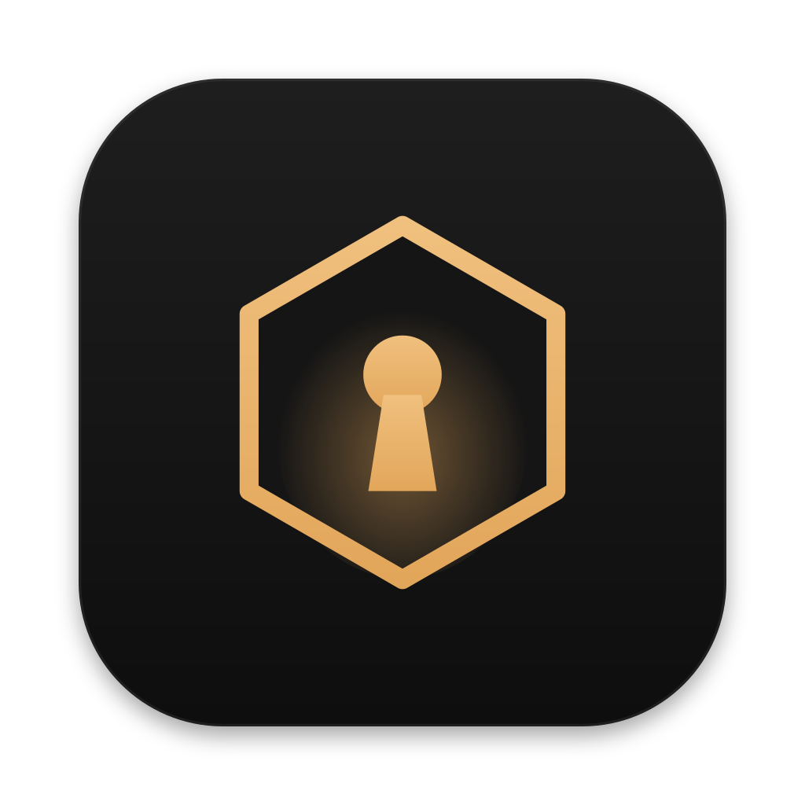
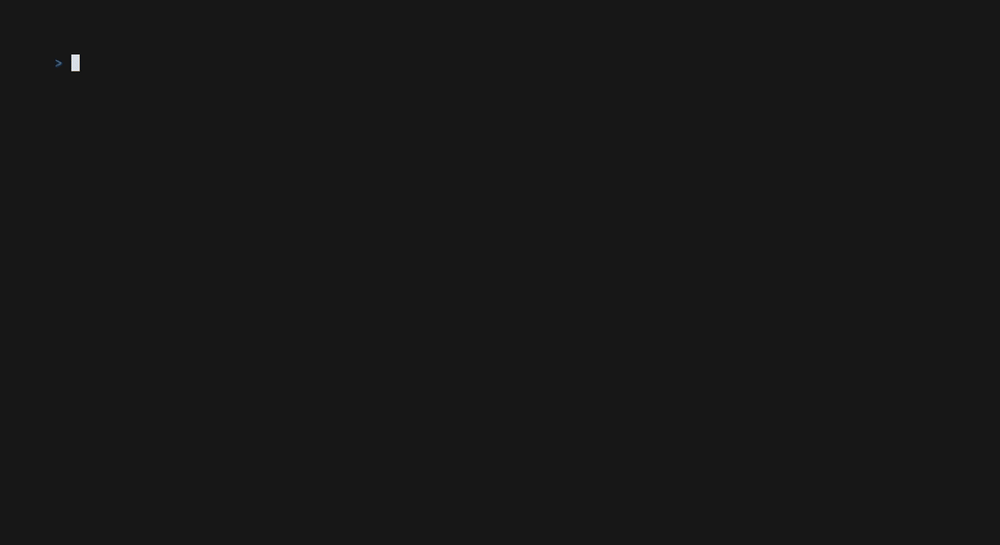
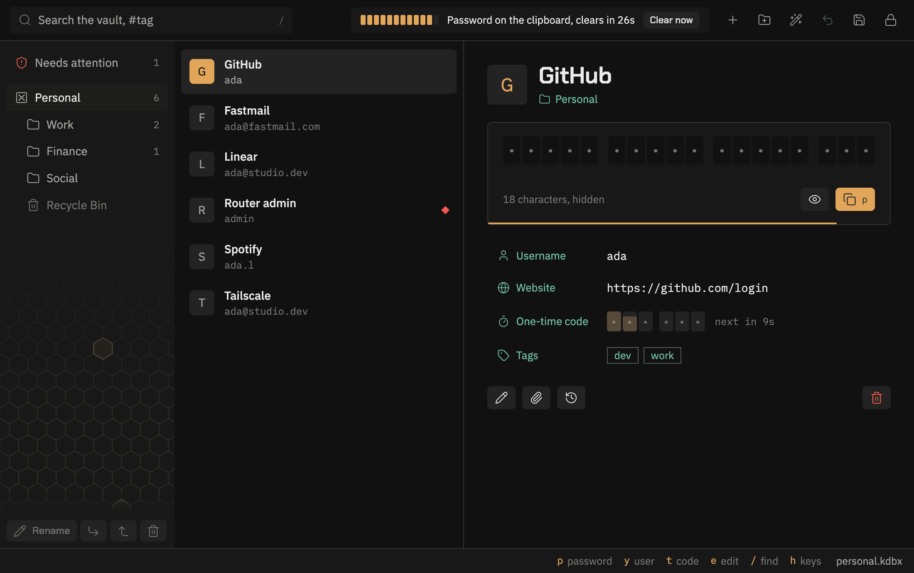

<div align="center">
  
  <h1>Sennel</h1>
  <p>
    <strong>A KeePass password manager for your terminal and your desktop.</strong><br>
    It opens the KeePass file you already have, and every copy wipes itself after 30 seconds.
  </p>
  <p>
    <a href="https://github.com/madebygrant/sennel/actions/workflows/ci.yml"></a>
    
    
  </p>
  <p>
    <a href="#install">Install</a> ·
    <a href="#features">Features</a> ·
    <a href="#documentation">Documentation</a>
  </p>
  
</div>

## Why Sennel

**No account, no server.** The vault is a `.kdbx` file, the format KeePassXC uses. It stays where
you put it, and you sync it with anything.

**Two keys to a password.** `/` and a few letters finds the entry, `p` copies it. The terminal app
and the desktop app share the keys.

**Careful by default.** An idle vault locks after five minutes and overwrites its secrets in memory.
If another app changed the file, Sennel won't save over it.

## Features

### Two apps, one vault



A terminal app and a native desktop app, built on one Rust core. They open the same vaults and share
settings, recent vaults, keys and colours. Run both at once if you like. [The desktop app](docs/desktop.md)

### Copy, then forget

- **One key per field.** `y` `p` `U` `t` copy the username, password, website or one-time code.
- **A clipboard with a timer.** Sennel wipes every copy after 30 seconds and shows the countdown.
  Quitting wipes it too, and clipboard managers are told not to keep a copy in their history.
- **Two-factor codes built in.** `t` copies the current code, never the seed behind it. The desktop
  app reads a code straight from a screenshot of the site's QR code. [One-time codes](docs/one-time-codes.md)
- **A generator on call.** `P` makes a password, passphrase or PIN and shows its strength in bits.
  One key each turns capitals, digits and symbols on or off for a site's rules. [Generating](docs/generate.md)

### Find anything

- **Fuzzy search that shows its work.** The letters that matched light up, so you can see why each
  result is there. It covers titles, usernames, websites and groups, never your notes.
- **Tags and expiry dates.** `#work` filters by tag. Expired entries are marked. [Finding entries](docs/search.md)
- **Every vault you use.** Work and personal can be two vaults. `^v` switches between them.
  [Vaults](docs/vaults.md)
- **Any action by name.** `:` opens a command palette that also tells you each action's key.
  [Keys](docs/keys.md)

### Safety nets

- **It audits itself.** `!` lists reused, weak, expired, empty and old passwords, worst first.
  `sennel audit --pwned` checks for breached passwords by sending five characters of a hash, never
  the password. [Auditing](docs/audit.md)
- **Deletes are never losses.** `D` moves to the recycle bin, and `u` undoes, step by step.
- **Safe with sync and with KeePassXC.** If another app changes the vault while it is open, Sennel
  won't overwrite it. It offers to merge both sets of changes instead.
- **Backups that stay home.** Sennel keeps three copies of the vault outside your sync folder, so
  Dropbox never uploads an old password. [Vaults, sync and safety nets](docs/vaults.md)
- **It locks itself.** After five idle minutes it overwrites every secret held in memory.
  [Security](docs/security.md)

### Works with what you have

- **KeePassXC opens what Sennel writes, and the other way round.** KDBX 4 throughout, with KeePass
  field references resolved. Older KDBX 3.1 vaults open read-only and convert in one command.
  [Field references](docs/vaults.md#field-references) · [Older files](docs/kdbx3.md)
- **Bring your passwords along.** Import from KeePassXC, Bitwarden or 1Password, and export to CSV
  or JSON whenever you want to leave. [Importing](docs/import.md) · [Exporting](docs/export.md)
- **Hardware keys and fingerprints.** YubiKey challenge-response slots and key files, plus Touch ID
  to reopen a vault after a lock on a Mac. [Security](docs/security.md)
- **SSH keys for your agent.** Unlocking can hand `ssh-agent` the keys stored in your vault, and
  locking takes them back. [Security](docs/security.md)
- **Custom fields and attachments.** `F` reads and edits them, and `H` shows or clears an entry's
  old versions. [Vaults](docs/vaults.md)

### Scriptable

```sh
sennel get github -p            # copy a password, wiped after 30 seconds
sennel get github --otp         # copy the current one-time code
sennel gen --stdout             # a new password, stored nowhere
sennel audit                    # what needs changing
sennel run -e PGPASSWORD=prod -- psql   # a program with a secret in its environment
```

`get` exits with codes a script can branch on, and `--stdout` pipes the value instead of copying it.
`run` hands secrets to a program without the clipboard or a shell variable.
[sennel get](docs/get.md) · [sennel run](docs/run.md) · [Reference for AI agents](docs/agents.md)

### Secrets for your projects

A project names the entries it needs in a file it can commit, and never keeps a `.env` of real
secrets that an AI agent or a stray commit could read:

```sh
# sennel.env: names entries, holds no secrets
DATABASE_URL=dev db::url
STRIPE_SECRET_KEY=stripe::api key
```

```sh
sennel run --group Projects/myapp --env-file sennel.env -- npm run dev
```

`--group` looks entries up in that project's group only, so a short name like `stripe` finds this
project's key and not another's. [A file per project](docs/run.md#a-file-per-project)

Or keep a whole `.env` in one entry, comments and all, and delete the file:

```sh
sennel env import "myapp dev" .env --group Projects/myapp
sennel run --entry "myapp dev" -- npm run dev
sennel env export "myapp dev" > .env   # for a tool that must read a file
```

Comments become labels and sections, and a commented-out variable is kept protected and left out of
`run`. In the desktop app, paste the file into the variables box and check the preview before
saving. [A whole .env file in one entry](docs/run.md#a-whole-env-file-in-one-entry)

## Install

Sennel runs on macOS and Linux.

### Download a release

The [latest release](https://github.com/madebygrant/sennel/releases/latest) has ready-built files:

| File | What it is |
| ---- | ---------- |
| `sennel-<version>-aarch64-apple-darwin.tar.gz` | terminal app and CLI, Apple silicon Mac |
| `sennel-<version>-x86_64-apple-darwin.tar.gz` | terminal app and CLI, Intel Mac |
| `sennel-<version>-x86_64-unknown-linux-gnu.tar.gz` | terminal app and CLI, Linux x86_64, glibc 2.35 or later |
| `sennel-<version>-aarch64-unknown-linux-gnu.tar.gz` | terminal app and CLI, Linux arm64, glibc 2.35 or later |
| `.dmg` | desktop app, Apple silicon Mac |
| `.AppImage` and `.deb` | desktop app, Linux x86_64, glibc 2.39 or later, such as Ubuntu 24.04 |
| `SHA256SUMS` | a checksum for every file above |

To install the terminal app and check it against `SHA256SUMS`, set `v` to the release's version
and `t` to your platform from the table. On Linux, use `sha256sum -c` in place of `shasum -a 256 -c`:

```sh
v=0.2.0 t=aarch64-apple-darwin
base=https://github.com/madebygrant/sennel/releases/download/v$v
curl -LO "$base/sennel-$v-$t.tar.gz" -LO "$base/SHA256SUMS"
grep " sennel-$v-$t.tar.gz\$" SHA256SUMS | shasum -a 256 -c
tar -xzf "sennel-$v-$t.tar.gz"
install -m 755 "sennel-$v-$t/sennel" ~/.local/bin/
```

Any folder on your `PATH` works in place of `~/.local/bin`. The builds have no Apple developer
signature, so macOS quarantines a `.dmg` downloaded in a browser. Open it once, then allow it under
System Settings › Privacy & Security. [More](docs/desktop.md)

### Build from source

Install from a clone. You need [Rust](https://rustup.rs) 1.88 or later, and the desktop app also
needs Rust 1.90 and [Node.js](https://nodejs.org):

```sh
git clone https://github.com/madebygrant/sennel.git && cd sennel
scripts/install.sh
```

It asks whether to install the terminal app and CLI, the desktop app, or both. `--cli`, `--desktop`
or `--both` skips the question, and a script or CI job has to pass one.

- The terminal app and CLI install as `sennel` in `~/.cargo/bin`, built from the clone's lockfile.
  `sennel run`, `sennel env` and the other subcommands come with it.
- The desktop app goes in `/Applications` as `Sennel.app` on a Mac. On Linux the AppImage installs
  as `~/.local/bin/sennel-desktop`, with a menu entry. [More](docs/desktop.md)

To install just the terminal app without a clone:

```sh
cargo install --git https://github.com/madebygrant/sennel.git sennel-tui --locked
```

## Quick start

```sh
sennel --db ~/vault.kdbx        # opens a vault, or creates it on first unlock
```

Sennel remembers the vault, so next time it is just `sennel`. The keys for day one:

| Key       | Does                                         |
| --------- | -------------------------------------------- |
| `/`       | search                                       |
| `j` `k`   | move up and down                             |
| `p`       | copy the password                            |
| `y` `t`   | copy the username, the one-time code         |
| `a` `e`   | add, edit an entry                           |
| `P`       | generate a password                          |
| `u`       | undo                                         |
| `h`       | every other key                              |

## Documentation

| Guide                                         | What it covers                                              |
| --------------------------------------------- | ----------------------------------------------------------- |
| [Keys](docs/keys.md)                          | every key, the unlock screen, the mouse and the menus       |
| [The desktop app](docs/desktop.md)            | building, installing and using the window                   |
| [Finding entries](docs/search.md)             | fuzzy search, tags, expiry dates and sort order             |
| [One-time codes](docs/one-time-codes.md)      | adding codes, including from a QR screenshot                |
| [Vaults, sync and safety nets](docs/vaults.md) | several vaults, merging, backups, undo and history         |
| [Generating passwords](docs/generate.md)      | passwords, passphrases and PINs, in the app and from a script |
| [Auditing](docs/audit.md)                     | what gets flagged, and the breach check                     |
| [Importing](docs/import.md) · [Exporting](docs/export.md) | moving between password managers              |
| [Older KDBX files](docs/kdbx3.md)             | KDBX 3.1 and `sennel convert`                               |
| [sennel get](docs/get.md)                     | secrets from the command line                               |
| [sennel run](docs/run.md)                     | a program with secrets in its environment, and `sennel env` |
| [The system keychain](docs/keychain.md)       | unlocking scripts without typing the master password        |
| [Themes](docs/themes.md)                      | six palettes, and how their contrast is measured            |
| [Configuration](docs/configuration.md)        | every setting in the config file                            |
| [Security](docs/security.md)                  | what is wiped, when, and why                                |
| [Reference for AI agents](docs/agents.md)     | every scriptable command, also indexed in [`llms.txt`](llms.txt) |

## Development

```sh
cargo build --release
cargo test
cargo clippy -- -D warnings
```

`sennel --check` prints what Sennel can see, such as the config, the vault and the clipboard, and
needs no terminal. Shell completions and a man page come from the binary:

```sh
sennel completions zsh > ~/.zfunc/_sennel    # bash, zsh, fish, elvish
sennel man > /usr/local/share/man/man1/sennel.1
```

The desktop app also needs Node.js. See [the desktop app](docs/desktop.md#building).

## License

MIT or Apache-2.0, at your option. See [LICENSE-MIT](LICENSE-MIT) and [LICENSE-APACHE](LICENSE-APACHE).

The passphrase wordlist is the [EFF large wordlist](https://www.eff.org/dice), CC-BY 3.0, minus four
hyphenated entries.
