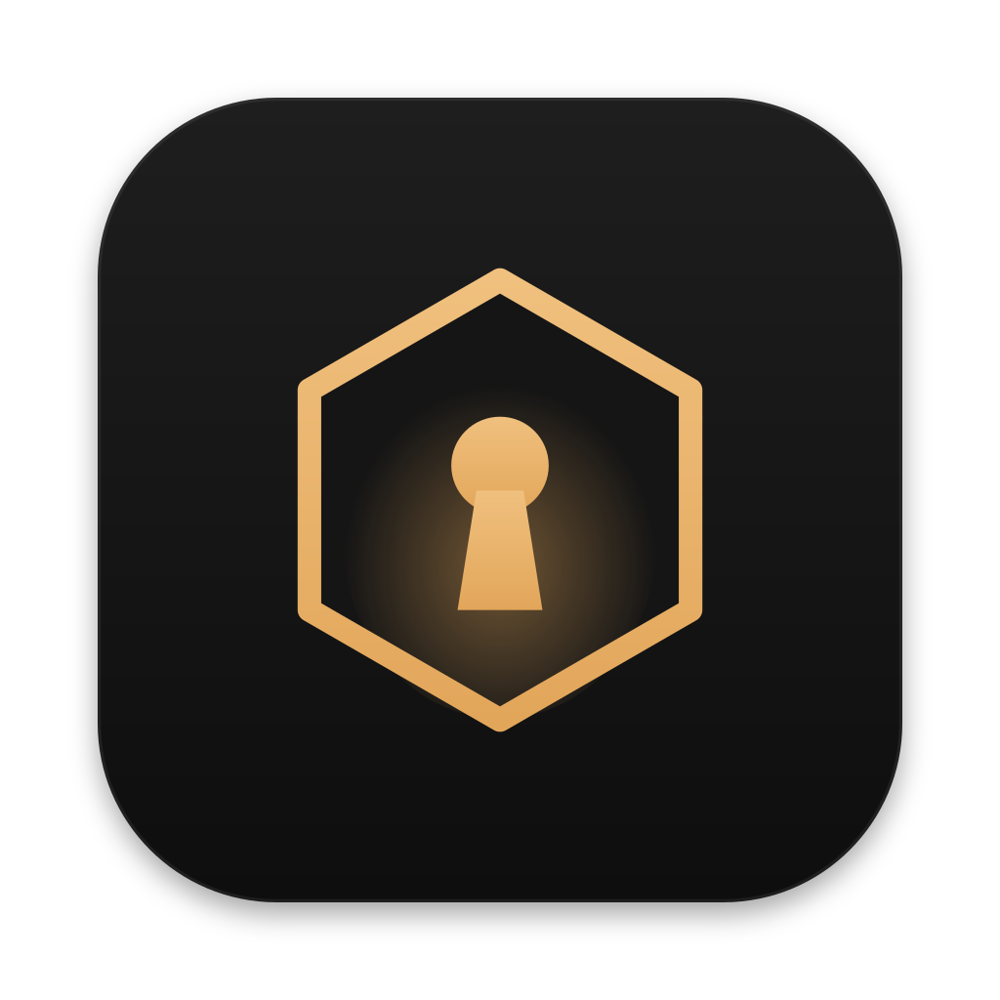
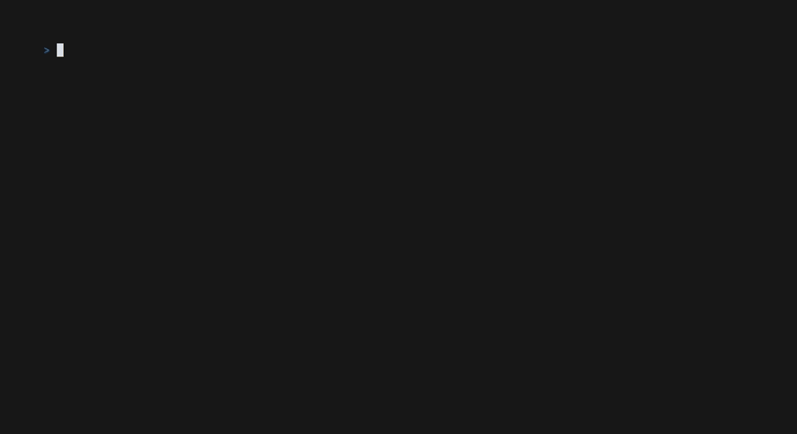
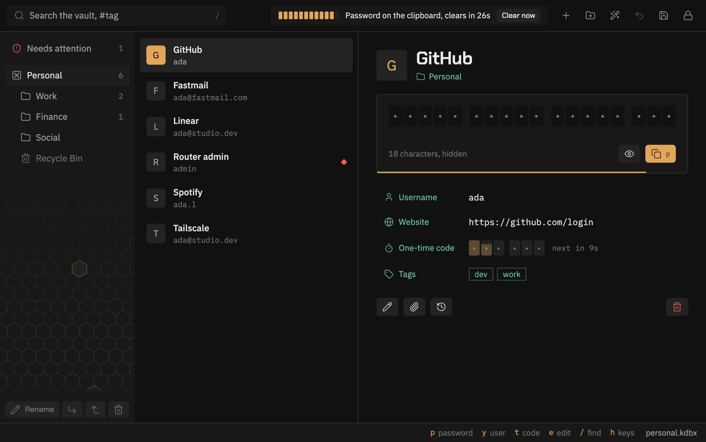

<div align="center">
  
  <h1>Sennel</h1>
  <p>
    <strong>A KeePass password manager for your terminal and your desktop.</strong><br>
    It opens the KeePass file you already have, and every copy wipes itself after 30 seconds.
  </p>
  <p>
    <a href="https://github.com/madebygrant/sennel/actions/workflows/ci.yml"></a>
    
    
  </p>
  <p>
    <a href="#install">Install</a> ·
    <a href="#features">Features</a> ·
    <a href="#documentation">Documentation</a>
  </p>
  
</div>

## Why Sennel

**No account, no server.** The vault is a `.kdbx` file, the format KeePassXC uses. It stays where
you put it, and you sync it with anything.

**Two keys to a password.** `/` and a few letters finds the entry, `p` copies it. The terminal app
and the desktop app share the keys.

**Careful by default.** An idle vault locks after five minutes and overwrites its secrets in memory.
If another app changed the file, Sennel won't save over it.

## Features

### Two apps, one vault



A terminal app and a native desktop app, built on one Rust core. They open the same vaults, read the
same settings and share the same list of recent vaults, with the same keys and the same colours. Run
both at once if you like. [The desktop app](docs/desktop.md)

### Copy, then forget

- **One key per field.** `y` `p` `U` `t` copy the username, password, website or one-time code.
- **A clipboard with a timer.** Sennel wipes every copy after 30 seconds and shows the countdown.
  Quitting wipes it too.
- **Two-factor codes built in.** `t` copies the current code, never the seed behind it. The desktop
  app reads a code straight from a screenshot of the site's QR code. [One-time codes](docs/one-time-codes.md)
- **A generator on call.** `P` makes a password, passphrase or PIN and shows its strength in bits.
  One key each turns capitals, digits and symbols on or off for a site's rules. [Generating](docs/generate.md)

### Find anything

- **Fuzzy search that shows its work.** The letters that matched light up, so you can see why each
  result is there. It covers titles, usernames, websites and groups, never your notes.
- **Tags and expiry dates.** `#work` filters by tag. Expired entries are marked. [Finding entries](docs/search.md)
- **Every vault you use.** Work and personal can be two vaults. `^v` switches between them.
  [Vaults](docs/vaults.md)
- **Any action by name.** `:` opens a command palette that also tells you each action's key.
  [Keys](docs/keys.md)

### Safety nets

- **It audits itself.** `!` lists reused, weak, expired, empty and old passwords, worst first.
  `sennel audit --pwned` checks for breached passwords by sending five characters of a hash, never
  the password. [Auditing](docs/audit.md)
- **Deletes are never losses.** `D` moves to the recycle bin, and `u` undoes, step by step.
- **Safe with sync and with KeePassXC.** If another app changes the vault while it is open, Sennel
  won't overwrite it. It offers to merge both sets of changes instead.
- **Backups that stay home.** Sennel keeps three copies of the vault outside your sync folder, so
  Dropbox never uploads an old password. [Vaults, sync and safety nets](docs/vaults.md)
- **It locks itself.** After five idle minutes it overwrites every secret held in memory.
  [Security](docs/security.md)

### Works with what you have

- **KeePassXC opens what Sennel writes, and the other way round.** KDBX 4 throughout. Older KDBX 3.1
  vaults open read-only and convert in one command. [Older files](docs/kdbx3.md)
- **Bring your passwords along.** Import from KeePassXC, Bitwarden or 1Password, and export to CSV
  or JSON whenever you want to leave. [Importing](docs/import.md) · [Exporting](docs/export.md)
- **Hardware keys and fingerprints.** YubiKey challenge-response slots and key files, plus Touch ID
  to reopen a vault after a lock on a Mac. [Security](docs/security.md)
- **SSH keys for your agent.** Unlocking can hand `ssh-agent` the keys stored in your vault, and
  locking takes them back. [Security](docs/security.md)
- **Custom fields and attachments.** `F` reads and edits them, and `H` shows or clears an entry's
  old versions. [Vaults](docs/vaults.md)

### Scriptable

```sh
sennel get github -p            # copy a password, wiped after 30 seconds
sennel get github --otp         # copy the current one-time code
sennel gen --stdout             # a new password, stored nowhere
sennel audit                    # what needs changing
```

`get` exits with codes a script can branch on, and `--stdout` pipes the value instead of copying it.
[sennel get](docs/get.md) · [Reference for AI agents](docs/agents.md)

## Install

Sennel runs on macOS and Linux.

### Terminal app

With [Rust](https://rustup.rs) 1.88 or later:

```sh
cargo install --git https://github.com/madebygrant/sennel.git
```

### Desktop app

From a clone, with Rust 1.90 or later and [Node.js](https://nodejs.org):

```sh
scripts/install-desktop.sh
```

It puts `Sennel.app` in `/Applications` on a Mac. On Linux it installs the AppImage as
`~/.local/bin/sennel-desktop`, with a menu entry. [More](docs/desktop.md)

## Quick start

```sh
sennel --db ~/vault.kdbx        # opens a vault, or creates it on first unlock
```

Sennel remembers the vault, so next time it is just `sennel`. The keys for day one:

| Key       | Does                                         |
| --------- | -------------------------------------------- |
| `/`       | search                                       |
| `j` `k`   | move up and down                             |
| `p`       | copy the password                            |
| `y` `t`   | copy the username, the one-time code         |
| `a` `e`   | add, edit an entry                           |
| `P`       | generate a password                          |
| `u`       | undo                                         |
| `h`       | every other key                              |

## Documentation

| Guide                                         | What it covers                                              |
| --------------------------------------------- | ----------------------------------------------------------- |
| [Keys](docs/keys.md)                          | every key, the unlock screen, the mouse and the menus       |
| [The desktop app](docs/desktop.md)            | building, installing and using the window                   |
| [Finding entries](docs/search.md)             | fuzzy search, tags, expiry dates and sort order             |
| [One-time codes](docs/one-time-codes.md)      | adding codes, including from a QR screenshot                |
| [Vaults, sync and safety nets](docs/vaults.md) | several vaults, merging, backups, undo and history         |
| [Generating passwords](docs/generate.md)      | passwords, passphrases and PINs, in the app and from a script |
| [Auditing](docs/audit.md)                     | what gets flagged, and the breach check                     |
| [Importing](docs/import.md) · [Exporting](docs/export.md) | moving between password managers              |
| [Older KDBX files](docs/kdbx3.md)             | KDBX 3.1 and `sennel convert`                               |
| [sennel get](docs/get.md)                     | secrets from the command line                               |
| [Themes](docs/themes.md)                      | six palettes, and how their contrast is measured            |
| [Configuration](docs/configuration.md)        | every setting in the config file                            |
| [Security](docs/security.md)                  | what is wiped, when, and why                                |
| [Reference for AI agents](docs/agents.md)     | every scriptable command, also indexed in [`llms.txt`](llms.txt) |

## Building from source

```sh
cargo build --release
cargo test
cargo clippy -- -D warnings
```

`sennel --check` prints what Sennel can see, such as the config, the vault and the clipboard, and
needs no terminal. Shell completions and a man page come from the binary:

```sh
sennel completions zsh > ~/.zfunc/_sennel    # bash, zsh, fish, elvish
sennel man > /usr/local/share/man/man1/sennel.1
```

The desktop app also needs Node.js. See [the desktop app](docs/desktop.md#building).

## License

MIT or Apache-2.0, at your option. See [LICENSE-MIT](LICENSE-MIT) and [LICENSE-APACHE](LICENSE-APACHE).

The passphrase wordlist is the [EFF large wordlist](https://www.eff.org/dice), CC-BY 3.0, minus four
hyphenated entries.
