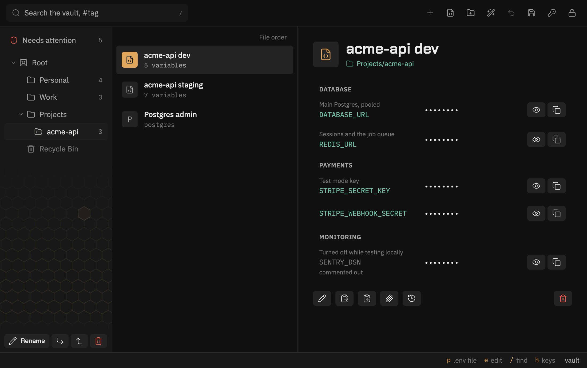
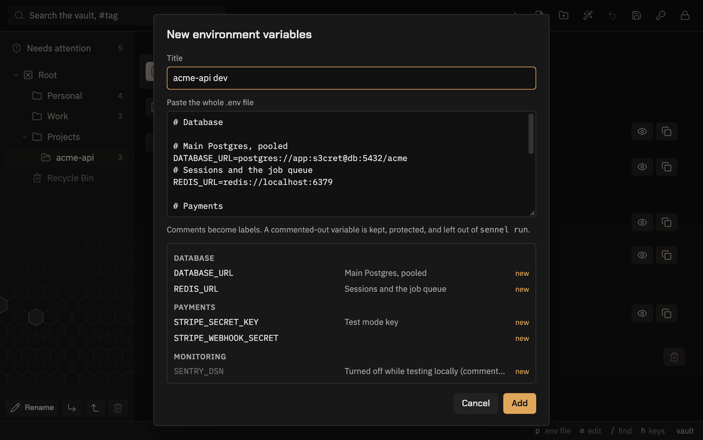

# sennel run

[Back to the README](../README.md)

Start a program with entry fields in its environment. The secrets go straight from the vault to the
program, never through the clipboard, a shell variable or your history.

```sh
sennel run -e PGPASSWORD=prod-postgres -- psql -h db.example.com -U app mydb
sennel run -e AWS_ACCESS_KEY_ID=aws::username -e AWS_SECRET_ACCESS_KEY=aws -- terraform apply
sennel run -e STRIPE_KEY="stripe::api key" -- npm run deploy
```

Each `-e VAR=NEEDLE` sets `VAR` to the password of the entry `NEEDLE` finds. Add `::FIELD` for
another field:

| Field              | What `VAR` gets                                   |
| ------------------ | ------------------------------------------------- |
| `::password`       | the password. The default when no field is named  |
| `::username`       | the username. `::user` works too                  |
| `::url`            | the url                                           |
| `::otp`            | the current one-time code, never the seed         |
| `::<name>`         | the custom field called `<name>`, exactly         |

The last `::` splits off the field, so a needle may contain one. A custom field named like a fixed
one, such as `username`, is reached by the fixed meaning, not the custom one.

The needle works as it does for [sennel get](get.md): an exact title wins, then a single fuzzy match.

Variable names are not restricted, so `PATH`, `LD_PRELOAD`, `DYLD_INSERT_LIBRARIES`,
`NODE_OPTIONS` or `BASH_ENV` can be set too. Whoever can write a reference, or an env entry in a
shared vault, can use one of those to run code in the program `run` starts.

## A file per project

Put a project's references in a file it can commit, and point `run` at it:

```sh
# sennel.env: names entries, holds no secrets
DATABASE_URL=dev db::url
STRIPE_SECRET_KEY=stripe::api key
export SESSION_SECRET="session secret"
```

```sh
sennel run --group Projects/myapp --env-file sennel.env -- npm run dev
```

- Each line is a `VAR=NEEDLE[::FIELD]` reference, the same as `-e`. Blank lines and lines starting
  with `#` are skipped. A leading `export ` and quotes around the right side are allowed.
- `-e` on the command line replaces the same variable from a file, so one run can point a
  variable at a different entry. The same variable twice in the files, or twice on the command
  line, is refused.
- `--env-file` can be given more than once. A mistake in a file is reported with its line number.
- The file is safe to commit and safe for an AI agent to read only while it names entries and holds
  no values. It is not safe for anyone to write: whoever can change it chooses which entries the
  program gets, from anywhere in the vault, and a pull request or a dependency's install script can
  change it. Pass `--group` in every script that uses a committed file, so it can only reach that
  group. Without `--group`, `run` says so on stderr each time. Do not point `--env-file` at a real
  `.env` full of secrets. It looks similar, but every
  value would be treated as an entry name to search for.
- If that happens anyway, nothing leaks into messages. A reference from a file is reported by its
  variable and line, such as `nothing matches DATABASE_URL at sennel.env:2`, never by what is on
  the right of the `=`.

A `package.json` script keeps the whole line in one place:

```json
"scripts": { "dev": "sennel run --group Projects/myapp --env-file sennel.env -- next dev" }
```

## A whole .env file in one entry

When a project has more variables than you want to name one by one, keep the whole `.env` file in
one entry and load all of it:



```sh
sennel env import "myapp dev" .env --group Projects/myapp
rm .env
sennel run --entry "myapp dev" -- npm run dev
```

- `env import` reads the file into the entry with exactly that title, creating it when there is
  none. Each variable becomes a protected custom field, so KeePassXC shows them too. It prints what
  it did to each variable (`new`, `changed`, `same`, `removed`) by name only. `--dry-run` shows
  that without writing.
- Importing into an existing env entry replaces its variables. An import that would remove a
  variable the new file lacks stops and says how many, unless you pass `--replace`. The desktop
  app shows removals in its preview, and its paste can be undone.
- Comments stay. A comment just above a variable, or after it on the same line, becomes its
  label. A comment followed by a blank line becomes a section heading. The desktop and terminal apps
  show both, and `env export` writes them back.
- A commented-out variable, such as `# OLD_KEY=sk-...`, is usually an old secret. It is stored as a
  protected field marked as commented out, never as plain text. `run --entry` leaves it out, and
  `env export` writes it back commented out. A prose comment shaped the same way, such as
  `# NOTE=see wiki`, is kept the same way.
- A file over 256 KB is refused. A line that is not `NAME=value`, a name that is not letters, digits and `_`, a name KeePass
  uses itself (`Title`, `UserName`, `Password`, `URL`, `Notes`), or the same variable twice stops
  the import with the line number. Nothing is written, and the line itself is never printed.
- Quoted values may span lines, such as a PEM key. Inside double quotes, `\n`, `\t`, `\"`, `\\`
  and `\$` are unescaped. `${OTHER}` is kept as written and not expanded. Use a
  [field reference](vaults.md#field-references) to share a value between entries.
- `pbpaste | sennel env import "myapp dev" -` reads the file from a pipe. The password then has to
  be typed at the terminal, since stdin is already taken.
- `run --entry` can be given more than once. `-e` and `--env-file` replace a variable of the same
  name from an entry. The same variable in two entries is refused.
- `sennel env export "myapp dev" > .env` writes the file back for a tool that has to read one. It
  refuses to print to a terminal unless you pass `--force`. The file is plaintext, so keep it out of
  git.

In the desktop app, the toolbar's code-file button opens a box to paste the file into. It previews
every variable, label and status before saving.



An env entry's view lists the variables by section, with show and copy buttons, plus buttons to replace them from a new paste or copy the whole file.

## Scoping lookups to a group

`--group PATH` looks every needle up only in that group and the groups below it. A short needle like
`stripe` then finds the project's own entry instead of matching every Stripe entry in the vault.

- The path runs down from the top of the tree, such as `Projects/myapp`, and ignores case. The
  top group's own name may lead it, as KeePassXC shows it: `Passwords/Projects/myapp`.
- A path that names no group, or more than one, stops before anything runs.
- A miss says where it looked: `nothing matches "stripe" in Projects/myapp`.

## What it checks before running anything

Every `-e` and every line of every `--env-file` is checked before the password prompt. A variable name that is not letters, digits and
`_`, a missing needle or field, or the same variable twice is refused first. Then every entry is
read before the program starts, so a typo or a missing field never runs the program with a variable
missing.

## The password

From a terminal, `run` prompts, and the program then gets the terminal as usual. Otherwise it reads
the first line of stdin, a pipe or a redirected file, and the program gets the rest:

```sh
security find-generic-password -a "$USER" -s sennel-master -w | sennel run -e PGPASSWORD=prod -- psql
```

[Unlocking from the system keychain](keychain.md) covers storing the master password that way.

## Exit codes

| Code | Meaning                                                |
| ---- | ------------------------------------------------------ |
| any  | the program ran, and this is its exit code             |
| 1    | Sennel failed first: bad password, no vault, bad `-e` or file line, no such group, a missing field |
| 2    | a needle matched more than one entry                   |
| 3    | a needle matched nothing                               |
| 126  | the program was found but could not start              |
| 127  | the program was not found                              |

A program can exit 1, 2 or 3 itself. Sennel's own failures always print `Error:` or a match message on
stderr first, so a script that needs to tell them apart can check stderr.

## What to know about environment variables

On Linux and macOS, Sennel becomes the program, the way `exec` does in a shell. Its signals and exit
code are the program's own, and no copy of the vault stays behind in a Sennel process.

The variables live in the program's environment for as long as it runs. Other processes running as
you can read another process's environment: `/proc/<pid>/environ` on Linux, `ps eww` on macOS.
Root can always read it. That is the same exposure as `PGPASSWORD=... psql` typed by hand, without
the shell history. Programs that start their own children pass the variables on to them.

The program also inherits Sennel's hardening: core dumps are off, so a crash of the program cannot
write its secrets to disk.
